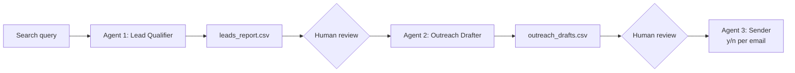

# AI Lead Finder: Multi-Agent Business Development System

**Live demo:** https://lead-finder-agent-rozm48rhb4bspf9n9gw95m.streamlit.app/

A three-agent system that finds local businesses, researches whether they're a good fit for an AI chatbot or automation service, and drafts personalized outreach emails. Every step that could damage a real relationship or reputation has a human approval gate.

The public demo runs Agents 1 and 2 only. Nothing can be sent from it, and scraped contact emails are hidden.

## How it works



**Agent 1: Lead Qualifier** (`agent1_find_leads.py`)
1. `search_leads.py` runs search queries through the Tavily Search API and filters out social media profiles, document hosts, and known directory domains.
2. `detect_chatbot.py` fetches each homepage and checks for fingerprints of common chat widgets (Intercom, Drift, Tidio, Tawk.to, Crisp, Zendesk, HubSpot, LiveChat).
3. `find_contact.py` finds a contact email (`mailto:` links first, then a text scan).
4. `analyze_lead.py` sends the page's visible text to Gemini, which summarizes the business and rates lead quality High, Medium, or Low. The prompt is grounded only in the page text and rejects directories and aggregators.
5. Per-URL failure isolation and retries, then writes `leads_report.csv`.

**Agent 2: Outreach Drafter** (`agent2_draft_outreach.py`)
- Reads High-quality leads that have a contact email.
- Optionally searches for a contact person's name. The name is always labeled a GUESS to verify, never treated as fact.
- Drafts a short, personalized email with a subject line, grounded in the real business type and reasoning from Agent 1, and writes `outreach_drafts.csv`. It never sends anything.

**Agent 3: Outreach Sender** (`agent3_send_outreach.py`)
- Sends emails through Gmail SMTP, but always asks for explicit y/n confirmation before every single email. There is no "send all" path.
- `TEST_MODE` is on by default, so every email goes to your own inbox, clearly labeled with the intended recipient.
- Live sends are capped per calendar day, tracked in `send_log.jsonl` across runs, with a delay between sends.

## Safety design

- Public APIs only. No scraping of private or authenticated platforms such as LinkedIn.
- Human gates at every handoff. A person decides who to pursue and approves every email.
- Hallucination control. Lead analysis and drafts are grounded only in what the site actually says, and the model is told not to invent details.
- Contact names are unverified guesses and are labeled as such in the output.
- The public demo never imports the sending code, and enforces usage caps: 3 leads per run, 3 runs per session, 30 runs per day.

## Tech stack

Python, Gemini API (`google-generativeai`), Tavily Search API, BeautifulSoup, Requests, Streamlit, Gmail SMTP.

## Project structure

```
agent1_find_leads.py       Agent 1 orchestrator
agent2_draft_outreach.py   Agent 2 drafter
agent3_send_outreach.py    Agent 3 sender (confirmation + daily cap)
search_leads.py            Tavily search + domain filtering
detect_chatbot.py          Chat widget detection
find_contact.py            Contact email extraction
analyze_lead.py            LLM lead analysis
send_email.py              Gmail SMTP sender (TEST_MODE)
run_all.py                 Runs all three agents in sequence
streamlit_app.py           Public demo (Agents 1 + 2, no sending)
```

## Setup

Use Python 3.11 or 3.12. Newer Python versions currently conflict with the pinned protobuf version.

```bash
git clone https://github.com/hasanmhk01-source/lead-finder-agent.git
cd lead-finder-agent
python -m venv venv
venv\Scripts\activate        # Windows
pip install -r requirements.txt
```

Create a `.env` file (never commit it):

```
GEMINI_API_KEY=your_gemini_key
TAVILY_API_KEY=your_tavily_key
SENDER_EMAIL=your_gmail_address        # Agent 3 only
SENDER_APP_PASSWORD=your_app_password  # Agent 3 only
TEST_MODE=true
```

- **Gemini key:** https://aistudio.google.com/apikey
- **Tavily key:** https://tavily.com (free tier, no card needed)
- **Gmail App Password (Agent 3 only):** turn on 2-Step Verification, then create an App Password at https://myaccount.google.com/apppasswords

## Running it

```bash
python -m streamlit run streamlit_app.py   # web demo (Agents 1 + 2)
python agent1_find_leads.py                # find and research leads
python agent2_draft_outreach.py            # draft outreach emails
python agent3_send_outreach.py             # review and send, one by one
```

Edit `SEARCH_QUERIES` in `agent1_find_leads.py` to change the business types and cities. Set `YOUR_NAME` and `YOUR_PORTFOLIO_LINK` in `agent2_draft_outreach.py` before drafting. Put URLs in `leads_input.txt` to research specific businesses instead of searching.

## Deploying the demo

1. Push to GitHub. `.env`, CSV files, and logs are excluded by `.gitignore`.
2. On share.streamlit.io, create an app from the repo with main file `streamlit_app.py`.
3. In Advanced settings, set **Python 3.11** and add `GEMINI_API_KEY` and `TAVILY_API_KEY` under Secrets.

## Known limitations

- The chatbot fingerprint list covers only about 8 providers.
- Only the homepage is checked, so a contact email on a `/contact` page is missed.
- Some sites block automated requests (403), and JavaScript-rendered pages are invisible to the fetcher.
- Lead-quality ratings vary slightly between runs. Treat them as a triage signal, not a precise score.
- Contact names found by Agent 2 are unverified and must be checked by a human.
- The Gemini free tier allows about 5 requests per minute, so a demo run takes 1-2 minutes.

## Roadmap

- Skip recipients who were already contacted (dedupe against `send_log.jsonl`).
- Check `/contact` and `/about` pages for emails.
- Migrate from `google-generativeai` to the newer `google-genai` SDK.
- Embeddable chatbot widget as the follow-up deliverable for won clients.
- Evaluation set to measure lead-quality consistency across runs.

## Author

Hasan Khan - https://github.com/hasanmhk01-source
